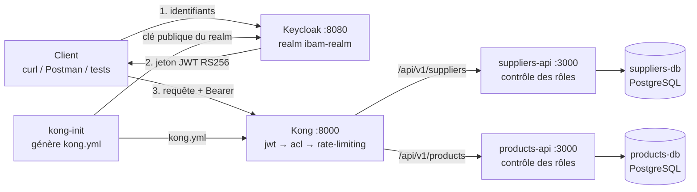

# Sécurisation de plusieurs API REST avec Kong API Gateway et Keycloak

> **Exercice 21 - Groupe 1 SI** : deux API REST indépendantes (fournisseurs, produits), exposées par Kong et protégées par des jetons JWT émis par Keycloak, avec contrôle des rôles, restriction par client et limitation du nombre de requêtes.

## Sommaire

1. [Présentation](#1-présentation)
2. [Architecture](#2-architecture)
3. [Technologies utilisées](#3-technologies-utilisées)
4. [Structure du dépôt](#4-structure-du-dépôt)
5. [Installation sur une machine neuve](#5-installation-sur-une-machine-neuve)
6. [Comptes et clients Keycloak](#6-comptes-et-clients-keycloak)
7. [Sécurité mise en place](#7-sécurité-mise-en-place)
8. [Les API](#8-les-api)
9. [Tests](#9-tests)
10. [Dépannage](#10-dépannage)

---

## 1. Présentation

| Exigence de l'exercice 21 | Réalisation |
|---------------------------|-------------|
| 1. Deux API REST indépendantes | `suppliers-api` et `products-api` (Node.js/Express), chacune avec sa propre base PostgreSQL et un CRUD complet |
| 2. Kong expose les routes publiques | `/api/v1/suppliers` et `/api/v1/products` sur le port 8000 ; les API ne sont pas accessibles directement |
| 3. Keycloak : utilisateurs, rôles, clients | Realm `ibam-realm` importé au démarrage : 3 utilisateurs, 2 rôles, 2 clients |
| 4. Politique d'authentification compatible avec Kong | Plugin `jwt` de Kong OSS 3.4 (RS256), clé publique Keycloak injectée automatiquement |
| 5. Limitation par client + 401, 403, 429 | Plugin `rate-limiting` par consumer (1 consumer Kong = 1 client Keycloak), plugin `acl`, contrôle des rôles dans les API |
| 6. Scénarios de test | Script automatisé : accès autorisé, jeton absent, jeton invalide, rôle insuffisant, client non autorisé, dépassement de quota |

---

## 2. Architecture



| Conteneur | Rôle | Port exposé |
|-----------|------|-------------|
| `keycloak` | Fournisseur d'identité : émet les jetons | 8080 |
| `kong-init` | Récupère la clé publique du realm et génère `kong.yml`, puis s'arrête | — |
| `kong` | Passerelle : routage, validation JWT, ACL, quotas | 8000 (admin : 127.0.0.1:8001) |
| `suppliers-api` / `products-api` | API REST (CRUD, pagination, filtres, rôles) | interne uniquement |
| `suppliers-db` / `products-db` | Bases PostgreSQL initialisées par `db/init.sql` | interne uniquement |
| `tests` | Tests de bout en bout (profil `test`, lancé à la demande) | — |

---

## 3. Technologies utilisées

| Rôle | Technologie |
|------|-------------|
| API Gateway | Kong 3.4 OSS (mode déclaratif / DB-less) |
| Gestionnaire d'identité | Keycloak 22.0.1 (realm auto-importé) |
| API | Node.js 18, Express 4, `pg` |
| Bases de données | PostgreSQL 16 |
| Orchestration | Docker et Docker Compose |
| Contrats d'API | OpenAPI 3.0 (`docs/`) |

---

## 4. Structure du dépôt

```text
projetDevComposantGroupe1SI/
├── docker-compose.yml
├── .env.example               # Variables (mots de passe) à copier en .env
├── README.md
├── docs/
│   ├── openapi-produits.yaml
│   └── openapi-fournisseurs.yaml
├── keycloak/
│   └── realm-export.json      # Realm, rôles, clients, utilisateurs
├── kong/
│   ├── kong.template.yml      # Configuration Kong (routes, plugins, consumers)
│   └── init/
│       └── generate-kong-config.js   # Injecte la clé publique Keycloak
├── products-api/
│   ├── app.js  auth.js  package.json  Dockerfile
│   └── db/init.sql            # Table products + 10 produits
├── suppliers-api/
│   ├── app.js  auth.js  package.json  Dockerfile
│   └── db/init.sql            # Table suppliers + 10 fournisseurs
└── tests/
    ├── run-tests.js           # Tests de bout en bout
    └── RESULTATS_ATTENDUS.md
```

---

## 5. Installation sur une machine neuve

### Prérequis

- Docker Desktop (ou Docker Engine) avec Docker Compose v2, démarré ;
- ports **8000**, **8001** et **8080** libres ;
- Git.

### Étapes

```bash
git clone https://github.com/kali6272/projetDevComposantGroupe1SI.git
cd projetDevComposantGroupe1SI
cp .env.example .env          # PowerShell : Copy-Item .env.example .env
docker compose up -d --build
docker compose ps
```

Au premier lancement, Keycloak met 30 à 60 secondes à démarrer. `kong-init` attend qu'il soit prêt, puis Kong démarre. Quand `docker compose ps` montre `kong` à l'état `Up` (et `kong-init` à l'état `Exited (0)`), le projet est prêt.

**Plus aucune clé RSA à copier à la main** : à chaque `docker compose up`, `kong-init` relit la clé publique actuelle du realm et régénère la configuration de Kong.

### Arrêt

```bash
docker compose down        # arrête les conteneurs
docker compose down -v     # arrête et supprime aussi les bases (réinitialisation complète)
```

---

## 6. Comptes et clients Keycloak

Console d'administration : http://localhost:8080 (admin / admin).

| Utilisateur | Mot de passe | Rôles | Droits |
|-------------|--------------|-------|--------|
| `admin1` | `admin123` | admin, user | Lecture et écriture |
| `user1` | `password123` | user | Lecture seule |
| `sansrole1` | `test123` | aucun | Aucun accès (403) |

| Client Keycloak | Consumer Kong | API autorisée |
|-----------------|---------------|---------------|
| `app-produits` | `app-produits` | `/api/v1/products` |
| `app-fournisseurs` | `app-fournisseurs` | `/api/v1/suppliers` |

---

## 7. Sécurité mise en place

Ordre d'exécution des plugins dans Kong : **jwt → acl → rate-limiting**, puis l'API.

| Contrôle | Où | Résultat en cas de refus |
|----------|----|--------------------------|
| Signature RS256 et expiration (`exp`) du jeton | Kong, plugin `jwt` | **401** |
| Le client Keycloak (claim `azp`) a-t-il accès à cette API ? | Kong, plugin `acl` | **403** |
| Quota de **10 requêtes par minute et par client** | Kong, plugin `rate-limiting` (`limit_by: consumer`) | **429** |
| Rôle de l'utilisateur (`realm_access.roles`) : `user` = GET, `admin` = GET/POST/PUT/DELETE | API (`auth.js`) | **403** |

**Pourquoi le plugin `jwt` ?** Le plugin `openid-connect` de Kong est réservé à la version Enterprise. Avec Kong OSS, la politique compatible consiste à valider les jetons RS256 de Keycloak avec le plugin `jwt`. Elle utilise la clé publique du realm, et `key_claim_name: azp` identifie chaque client Keycloak comme un consumer Kong distinct. C'est ce qui rend possibles les ACL et les quotas **par client**.

Un plugin `correlation-id` ajoute aussi un en-tête `X-Correlation-ID` à chaque requête et réponse.

---

## 8. Les API

Contrats complets : [`docs/openapi-produits.yaml`](docs/openapi-produits.yaml) et [`docs/openapi-fournisseurs.yaml`](docs/openapi-fournisseurs.yaml) (à ouvrir dans https://editor.swagger.io).

| Méthode | Route (via Kong) | Rôle requis | Codes |
|---------|------------------|-------------|-------|
| GET | `/api/v1/products?page=1&limit=10&name=...` | user ou admin | 200 |
| GET | `/api/v1/products/{id}` | user ou admin | 200, 400, 404 |
| POST | `/api/v1/products` | admin | 201, 400 |
| PUT | `/api/v1/products/{id}` | admin | 200, 400, 404 |
| DELETE | `/api/v1/products/{id}` | admin | 204, 404 |
| GET | `/api/v1/suppliers?page=1&limit=10&name=...&status=actif` | user ou admin | 200 |
| GET | `/api/v1/suppliers/{id}` | user ou admin | 200, 400, 404 |
| POST | `/api/v1/suppliers` | admin | 201, 400, 409 (email déjà utilisé) |
| PUT | `/api/v1/suppliers/{id}` | admin | 200, 400, 404, 409 |
| DELETE | `/api/v1/suppliers/{id}` | admin | 204, 404 |

Toutes les routes peuvent aussi renvoyer 401, 403 et 429 (voir section 7).

---

## 9. Tests

### 9.1 Tests automatiques (recommandé)

```bash
docker compose --profile test run --rm tests
```

Le script attend le début d'une minute (pour partir de quotas remis à zéro), puis exécute 19 tests. Il se termine par un tableau récapitulatif et `Tous les tests sont réussis (19/19).` Le détail des scénarios et des codes attendus est dans [`tests/RESULTATS_ATTENDUS.md`](tests/RESULTATS_ATTENDUS.md).

| Scénario exigé | Tests | Code |
|----------------|-------|------|
| Accès autorisé + bout en bout | A1 à A7, F1, F2 | 200, 201, 204 |
| Jeton absent | J1 | 401 |
| Jeton invalide | J2, J3, J4 | 401 |
| Rôle insuffisant | R1, R2, F3 | 403 |
| Client non autorisé sur l'API | C1 | 403 |
| Dépassement de quota (par client) | Q1, Q2 | 429 puis 200 pour l'autre client |

### 9.2 Tests manuels (PowerShell)

**Obtenir un jeton** (admin1, client app-produits) :

```powershell
$TOKEN = (Invoke-RestMethod -Method Post `
  -Uri "http://localhost:8080/realms/ibam-realm/protocol/openid-connect/token" `
  -Body @{ grant_type="password"; client_id="app-produits"; username="admin1"; password="admin123" }).access_token
```

Avec curl (Git Bash, Linux, macOS) :

```bash
TOKEN=$(curl -s -X POST http://localhost:8080/realms/ibam-realm/protocol/openid-connect/token \
  -d grant_type=password -d client_id=app-produits -d username=admin1 -d password=admin123 \
  | sed -E 's/.*"access_token":"([^"]+)".*/\1/')
```

| Cas | Commande (PowerShell, `curl.exe`) | Attendu |
|-----|-----------------------------------|---------|
| Accès autorisé | `curl.exe -i -H "Authorization: Bearer $TOKEN" http://localhost:8000/api/v1/products` | 200 |
| Création | `curl.exe -i -X POST -H "Authorization: Bearer $TOKEN" -H "Content-Type: application/json" -d '{\"name\":\"Ballon\",\"price\":12000}' http://localhost:8000/api/v1/products` | 201 |
| Jeton absent | `curl.exe -i http://localhost:8000/api/v1/products` | 401 |
| Jeton invalide | `curl.exe -i -H "Authorization: Bearer faux_token_123" http://localhost:8000/api/v1/products` | 401 |
| Client non autorisé | `curl.exe -i -H "Authorization: Bearer $TOKEN" http://localhost:8000/api/v1/suppliers` | 403 |
| Rôle insuffisant | Refaire « Obtenir un jeton » avec `user1` / `password123`, puis la commande « Création » | 403 |
| Quota dépassé | `1..12 \| % { curl.exe -s -o NUL -w "%{http_code}\`n" -H "Authorization: Bearer $TOKEN" http://localhost:8000/api/v1/products }` | 200 ×10 puis 429 |

Les en-têtes `X-RateLimit-Remaining-Minute` des réponses montrent le nombre de requêtes restantes. Le jeton expire après 5 minutes : en cas de 401 inattendu, redemandez-en un.

---

## 10. Dépannage

| Symptôme | Cause probable | Solution |
|----------|----------------|----------|
| `kong` ne démarre pas, `kong-init` en `Exited (1)` | Keycloak trop lent à démarrer | `docker compose up -d` (relance `kong-init` puis Kong) |
| 401 avec un jeton valide | Jeton expiré (5 min) ou Keycloak recréé sans relancer `kong-init` | Redemander un jeton ; `docker compose up -d --force-recreate kong-init kong` |
| 403 `You cannot consume this service` | Jeton demandé avec le mauvais client | Utiliser `app-produits` pour les produits, `app-fournisseurs` pour les fournisseurs |
| 429 trop tôt | Quota de 10 requêtes/minute atteint | Attendre la minute suivante |
| Port déjà utilisé | Un autre service occupe 8000, 8001 ou 8080 | Libérer le port ou modifier `ports` dans `docker-compose.yml` |
| Données modifiées à réinitialiser | Les bases sont conservées dans des volumes | `docker compose down -v` puis `docker compose up -d --build` |
